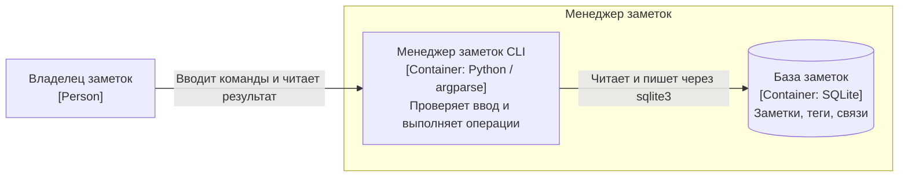
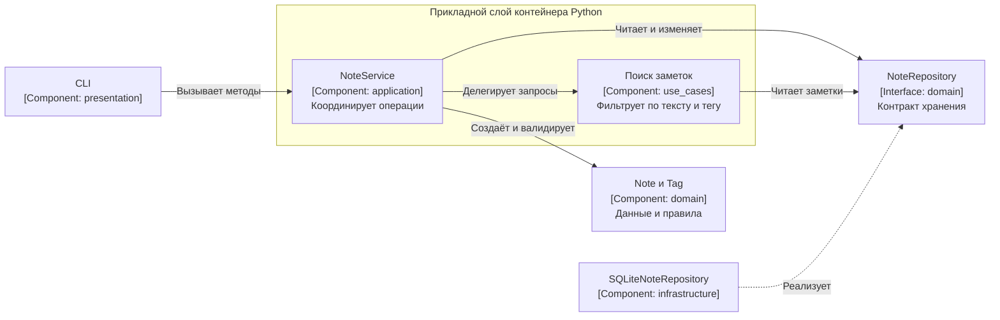

# Архитектура менеджера заметок

В слое `presentation` CLI преобразует аргументы в вызовы `NoteService` и выводит результат. Сервис из `application` координирует операции. `domain` содержит `Note`, `Tag`, правила валидации, ошибки и контракт `NoteRepository`. Конкретный адаптер SQLite находится в `infrastructure`. При запуске CLI передаёт адаптер сервису через конструктор.

В SQLite отношение многие-ко-многим хранится в таблице `note_tags`. Запись заметки и её тегов проходит одной транзакцией. Тесты сервиса подставляют объект с интерфейсом `NoteRepository`, а интеграционные тесты используют временный файл.

## C4. Контейнеры

## C4. Компоненты прикладного слоя

## Проверка зависимостей

`python scripts/check_layers.py` разбирает обычные и относительные импорты. `domain` может обращаться к доменным модулям, `application` — к домену. `infrastructure` реализует доменные контракты. `presentation` связывает компоненты при запуске. Скрипт запускается в CI.
